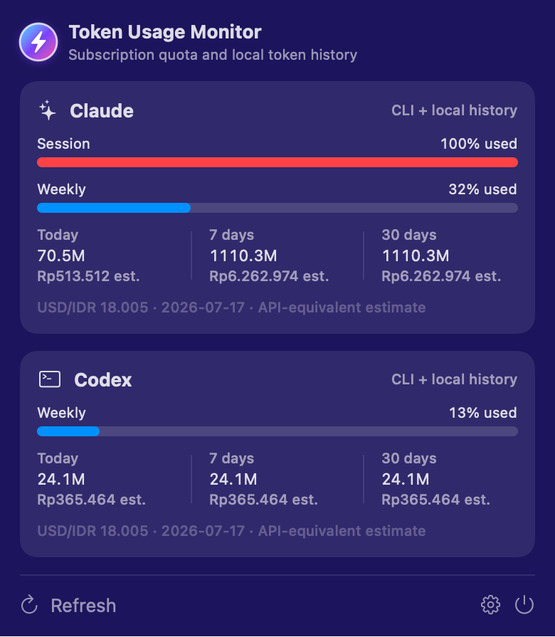

# Token Usage Monitor

[](https://github.com/pramestihattak/token-usage-monitor/actions/workflows/ci.yml)
[](https://github.com/pramestihattak/token-usage-monitor/releases/latest)
[](https://github.com/pramestihattak/token-usage-monitor/releases/latest)

A private-by-design native macOS menu-bar app for monitoring Claude Code and OpenAI Codex subscription quota, local token history, and API-equivalent cost estimates.

**[Download the latest universal DMG](https://github.com/pramestihattak/token-usage-monitor/releases/latest)**

## Preview



## Features

- One compact menu-bar icon with separate Claude and Codex cards.
- Session and weekly quota meters with reset countdowns.
- Today, seven-day, and thirty-day local token totals.
- Input, output, cached-input, cache-creation, and reasoning token support.
- API-equivalent cost estimates converted from USD to IDR using a dated exchange rate.
- Local notifications at 80% and 95% utilization, deduplicated per reset window.
- Automatic history refresh plus configurable quota refresh intervals.
- Launch-at-login option, disabled by default.
- No external Swift package dependencies.

## Requirements

- macOS 14 Sonoma or newer.
- An Apple Silicon or Intel Mac.
- Claude Code and/or OpenAI Codex installed and signed in.

“ChatGPT usage” in this app means Codex quota authenticated through a ChatGPT plan. It does not read ordinary ChatGPT web or desktop conversations.

## Install

1. Download `Token-Usage-Monitor-<version>-universal.dmg` from [GitHub Releases](https://github.com/pramestihattak/token-usage-monitor/releases/latest).
2. Open the DMG.
3. Drag **Token Usage Monitor** into **Applications**.
4. Open the app. It runs only in the menu bar and does not add a Dock icon.

Releases are ad-hoc signed but not Apple-notarized. On first launch, macOS may say it cannot verify the developer. Control-click **Token Usage Monitor** in Applications, choose **Open**, then confirm **Open**. This exception applies only to this app; do not disable Gatekeeper globally.

## How it works

### Claude Code

- Reads token counters from Claude Code JSONL history, including subagents.
- Deduplicates repeated assistant messages.
- Runs Claude Code in a restricted hidden pseudo-terminal, invokes `/usage`, parses subscription quota windows, and exits with a strict timeout.

### Codex

- Reads cumulative token events from active and archived Codex histories and converts them into deltas.
- Deduplicates copies of the same session.
- Queries `codex app-server` for rate-limit windows and falls back to the latest local `rate_limits` event when needed.

Provider failures are isolated. For example, a changed Claude `/usage` format does not prevent Claude history totals or Codex data from appearing.

## Pricing and exchange rates

Costs are API-equivalent estimates, not actual Claude or ChatGPT subscription charges. The bundled dated pricing catalog applies separate rates where available and reports unknown models as “Price unavailable” instead of treating them as free.

USD estimates are converted to IDR using the public [Frankfurter](https://frankfurter.dev/) exchange-rate service. The latest successful quote is cached locally for offline display.

## Privacy

Token Usage Monitor is local-first:

- It extracts usage counters, timestamps, model identifiers, session identifiers, and quota metadata.
- It does not retain conversation text, prompts, provider credentials, analytics, or telemetry.
- It uses the existing authenticated Claude Code and Codex command-line tools instead of reading their credentials.
- Cached snapshots and preferences remain under the current user’s Library/Application Support and UserDefaults storage.
- The app directly contacts only the USD/IDR exchange-rate service. The Claude Code and Codex processes it launches may contact Anthropic and OpenAI to retrieve current quota data.
- External CLI output is reduced to generic errors before snapshots are cached.

## Security

- Claude Code runs with `--safe-mode`, which disables project and user customizations such as hooks, plugins, MCP servers, skills, and custom commands.
- CLI executables are resolved to regular files and rejected when group- or world-writable.
- Local cache directories and files are written with `0700` and `0600` permissions.
- Release workflows use least-privilege GitHub tokens, immutable Action revisions, and build-provenance attestations.

Please report vulnerabilities privately using [GitHub’s security advisory form](https://github.com/pramestihattak/token-usage-monitor/security/advisories/new), not a public issue.

## Settings

Open the menu-bar popover and select the gear icon to configure:

- 80% and 95% notifications.
- Launch at login.
- Claude and Codex executable path overrides.
- One-, five-, or fifteen-minute quota refresh intervals.

## Troubleshooting

### A provider says the CLI is missing

Install the relevant CLI, or set its full executable path in Settings. The app searches `PATH` and common installation locations automatically.

### Quota is unavailable

Run `claude auth status` or confirm that `codex` is signed in. A CLI update may also have changed an undocumented output format; local history totals should continue to work.

### Costs are unavailable

The model may not exist in the bundled pricing catalog, or no USD/IDR quote has been cached yet. Refresh after connecting to the internet.

## Build from source

The project is a dependency-free Swift 6 package:

```sh
DEVELOPER_DIR=/Applications/Xcode.app/Contents/Developer \
swift test --disable-sandbox

APP_VERSION=1.0.0 BUILD_NUMBER=1 ./scripts/package-app.sh
APP_VERSION=1.0.0 BUILD_NUMBER=1 ./scripts/package-dmg.sh
```

The app script cross-compiles `arm64` and `x86_64` executables and merges them into a universal binary. Outputs are written under `dist/`.

To install a local build into `~/Applications`:

```sh
./scripts/install-app.sh
```

## Releases

CI tests and packages every push and pull request to `main`. A semantic version tag publishes a GitHub Release:

```sh
git tag v1.0.0
git push origin v1.0.0
```

The release contains a universal DMG and SHA-256 checksum.

## License

[MIT](LICENSE)
